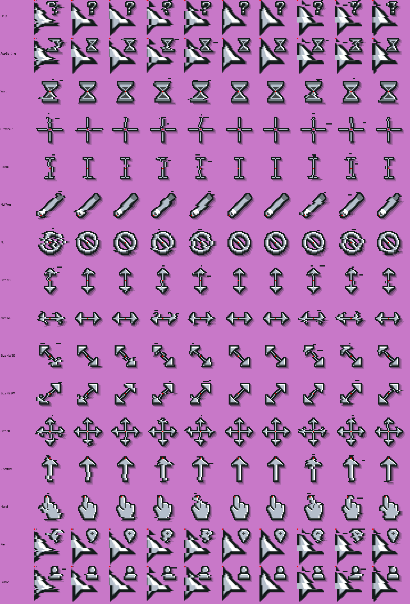

# Pibby Glitch Cursor

A fully glitched, animated mouse cursor set for **Windows** and **Linux**, with a one-click installer app.



- **The normal arrow** is the original 10-frame glitch animation, frame-for-frame and pixel-for-pixel, at the same 60 fps.
- **16 more pointers** match it: text, link hand, busy, help, resize, move and the rest. They're drawn in the same pixel style and glitch on the same rhythm.
- **Pixel-exact at normal size**, with clean 2×/3×/4× copies for high-DPI screens.

## Download & install

Get the latest version from **[Releases](../../releases)**:

| System | Download | How |
|---|---|---|
| Windows | `PibbyGlitchCursorInstaller.exe` | Double-click it. No admin rights are needed. If Windows warns the app is unrecognized, click *More info → Run anyway* (it isn't code-signed). |
| Linux (app) | `PibbyGlitchCursorInstaller-x86_64.AppImage` | Make it executable (`chmod +x`, or Properties → Allow executing), then run it. |
| Linux (no app) | `PibbyGlitchCursor-linux.zip` | Unzip it, then run `sh install.sh`. |

The installer app:
- **Detects** your current cursors, with a per-pointer **Details** view.
- **Install / Uninstall:** one click each.
- **Backup:** saves your current custom cursors first, including copies of the cursor files.
- **Restore backup:** brings them back.

To install without the app, see [dist/README.md](dist/README.md).

## Build from source

You need Python 3 with tkinter, and `pip install pillow pyinstaller`. Then:

```sh
python build_cursors.py      # cursor files -> dist/windows, dist/linux
python build_installer.py    # installer app -> dist/ (.exe on Windows, .AppImage on Linux)
```

| File | What it is |
|---|---|
| `images/cursor/`, `scripts/cursor.lua` | The original frames and animation script |
| `glitch_pointers.py` | Pixel art and glitch engine for the other 16 pointers |
| `build_cursors.py` | Writes Windows `.ani` files and the Linux Xcursor theme |
| `installer_gui.py` | The installer app (Windows and Linux) |
| `credits.py` | The credits list (also used to write `CREDITS.md`) |

## Credits

- Based on the **[Pibby Apocalypse Cursor Recreation Script](https://gamebanana.com/tools/15314)** by **[jarekboho](https://gamebanana.com/members/2145650)**.
- The cursor art comes from **[Pibby: Apocalypse](https://gamebanana.com/wips/73842)** by the Pibby: Apocalypse Team, licensed [CC BY-NC 4.0](https://creativecommons.org/licenses/by-nc/4.0/).
- The full team list is in [CREDITS.md](CREDITS.md).

This is a free, non-commercial fan project.
